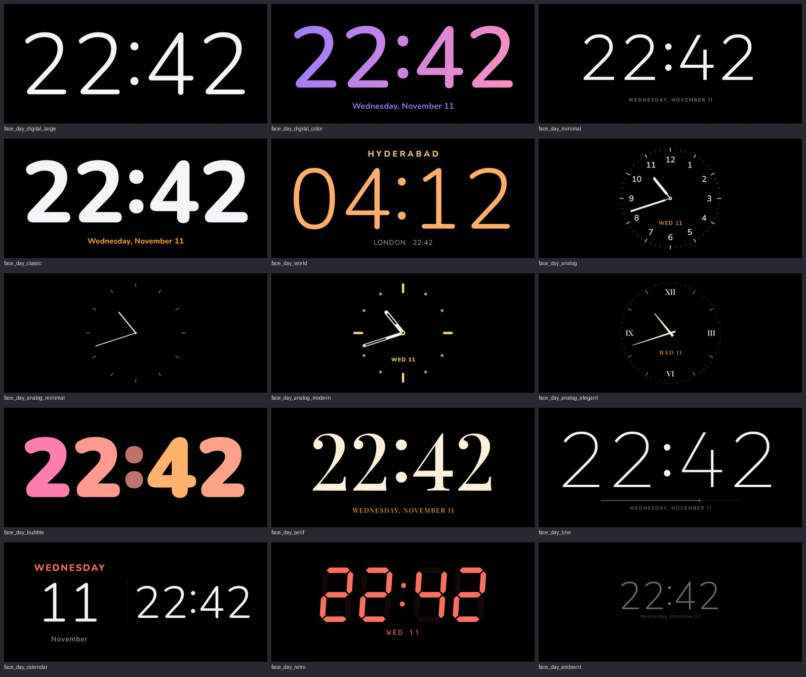
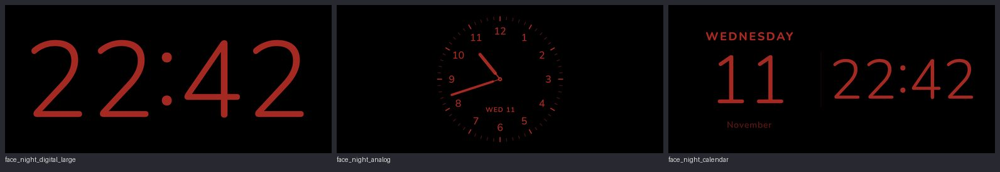

# StandBy Clock

**StandBy Clock turns your Android phone into a bedside display while charging.**

Put your phone on a charger, turn it sideways on a stand, and it becomes a large, OLED-friendly
clock with optional side panels (date, battery, next alarm, weather placeholder) — similar in
concept to iPhone StandBy, built entirely with native Android APIs (Kotlin, Jetpack Compose,
Material 3). No network access, no accounts. The core app needs no permissions; only the opt-in
"Lock-screen auto start" feature asks for notification permissions (see [Permissions](#permissions)).

> Honest summary: Android does **not** let an ordinary app take over a locked phone on its own the
> moment it is plugged in. StandBy Clock therefore offers the two closest *legitimate* mechanisms —
> a StandBy activity that can show over the lock screen, and an Android screen saver (Dream) that
> the system starts automatically while charging. Details in [Android limitations](#android-limitations).

---

## Features

| Area | What you get |
|---|---|
| Activation | Charging + landscape (default), charging only, landscape only (no charger), manual, screen saver, Quick Settings tile |
| No charger | NiteStand Quick Settings tile (one tap, also from the lock screen), opt-in lock-screen auto start, battery screen-on timeout |
| Diagnostics | Live report of what the phone allows (screen saver, keyguard, permissions, sensor angles, StandBy state) with copyable event log |
| Orientation | Physical orientation from the gravity sensor / accelerometer, both landscape directions, configurable tolerance, hysteresis and settle time |
| Clock faces | 15 Apple StandBy-inspired faces in a live-preview gallery (5 digital, 4 analog, 6 expressive) with per-face colours — swipe on StandBy to switch |
| Widgets | Clock, Date, Battery (percentage + status), Next alarm, Weather (sample data) |
| Display | Immersive full screen, sensor-landscape (auto 180° flip), keep-screen-on only while active |
| Brightness | Auto / Low / Medium / High per-window override, ramped smoothly; Night mode (dim red, lowest brightness) Off / Always on / Automatic schedule, with a 2.5 s cross-fade |
| Burn-in | Slow pixel shift (a few dp every 30–120 s) plus occasional re-anchoring |
| Exit | Double-tap, back gesture, or TalkBack "Exit StandBy" action |
| Extras | Screen saver (Dream), "NiteStand" Quick Settings tile, launcher shortcut |
| Accessibility | TalkBack labels for clock and widgets, custom actions, 48 dp targets, reduced motion (app setting + system animator scale), high-contrast colours |

---

## Clock faces

Settings › **Clock faces** (or *Clock faces* on the start screen) opens a gallery of live
previews. Tapping a face selects it straight away and opens a sheet to choose its colour, 12/24-hour
time, seconds, AM/PM, date and date style, and (World) cities. The sheet also previews night mode and
can show the face full screen. Every face shows the real system time and is drawn natively in Compose
Canvas or with native text: there are no images, videos or prerecorded animations.



| Category | Face | Character | Colours |
|---|---|---|---|
| Digital | **StandBy** (default) | Huge light rounded digits, nothing else | all 9 |
| Digital | Color | Two-tone gradient digits | 7 colourful palettes |
| Digital | Minimal | Thin geometric numerals, tiny tracked date | white, warm white, orange, blue |
| Digital | Rounded Bold | Heavy rounded digits, accent date | all 9 |
| Digital | World | Chosen city + optional second zone with offset | 5 |
| Analog | Analog | Rounded numerals 1–12, watch-style hands | 6 (accent) |
| Analog | Analog Minimal | Twelve hairline marks, thin hands | white, warm white |
| Analog | Analog Modern | Dots and bars, bold skeleton hands | 7 (accent) |
| Analog | Analog Elegant | Serif Roman numerals, tapered hands | 3 |
| Expressive | Bubble | Heavy rounded numerals, per-digit colours | 7 |
| Expressive | Serif | High-contrast display serif | 4 |
| Expressive | Line | Hairline numerals over a line that fills each hour | 5 |
| Expressive | Calendar | Weekday, big day number, month, time | 4 |
| Expressive | Retro | Seven-segment LED | 5 LED colours |
| Expressive | Ambient | Small and very dim | fixed |

Night mode turns every face into StandBy-style dim red on black:



**How it is built** (`clock/`, `ui/clock/`):

* `ClockFaceCatalog` declares, per face, its category, allowed `ClockPalette`s, and whether it
  supports a date, seconds or AM/PM, the side panel or world time. Settings, the gallery and the
  renderer read the same specification.
* `ClockFormatter` decides 12/24-hour, seconds, AM/PM and date style once, centrally.
  `ClockFaceData.build` applies the face's capabilities to it, so faces never format time themselves.
* `TimeText` is the shared digital renderer. It draws with a native `Paint` on a Canvas and centres
  the digits optically using their real glyph bounds rather than the line box. It raises the colon to
  the middle of the digits, stacks AM/PM (aligned to the digit top) over seconds (aligned to the
  baseline), and uses tabular lining figures, gradients and per-digit colour. Paints are reused
  between frames.
* `StandByStyle` derives colours from the palette and interpolates towards night red, which gives
  the smooth night transition.
* Adding a face takes three steps: an enum entry, a `ClockFaceSpec`, and a composable in the
  `ClockFace` dispatcher.

### Fonts and licences

Apple's fonts and assets are **not** used or redistributed. The faces are original implementations
*inspired by* StandBy, built with openly licensed fonts bundled in `res/font`:

| Font | Used for | Licence |
|---|---|---|
| [Nunito](https://github.com/googlefonts/nunito) (variable 200–1000) | Rounded digits (StandBy, Color, Bold, World, Bubble, Calendar, Ambient, Analog numerals) | SIL Open Font License 1.1 |
| [Outfit](https://github.com/Outfitio/Outfit-Fonts) (variable 100–900) | Thin geometric digits (Minimal, Line) | SIL Open Font License 1.1 |
| [Playfair Display](https://github.com/clauseggers/Playfair-Display) (variable 400–900) | Serif and Analog Elegant | SIL Open Font License 1.1 |

The licence texts ship in `assets/licenses` and are shown in Settings › Open-source fonts. The
fonts came from the official Google Fonts repository.

## How StandBy activation works

```
             ┌──────────── settings (DataStore)
             │   ┌──────── battery broadcasts (ACTION_BATTERY_CHANGED, POWER_CONNECTED/DISCONNECTED)
             │   │   ┌──── gravity sensor → OrientationClassifier (threshold + hysteresis + settle)
             ▼   ▼   ▼
        StandByStateMachine ──► IDLE │ CHARGING │ WAITING_FOR_LANDSCAPE │ READY │ ACTIVE
                                                                                 │
                         StandByActivity / StandByDreamService apply window state ◄┘
```

States:

| State | Meaning |
|---|---|
| `IDLE` | StandBy disabled, waiting for power, or manual mode waiting for a tap |
| `CHARGING` | Power requirement met, orientation not measured yet |
| `WAITING_FOR_LANDSCAPE` | Power requirement met, phone not in landscape |
| `READY` | All conditions met but not shown (auto start off, or the user exited) |
| `ACTIVE` | StandBy is on screen |

Activation modes (Settings › Activation mode):

| Mode | Starts when | Charger needed |
|---|---|---|
| Charging + landscape (default) | StandBy is open (or lock-screen auto start is on) and the phone is charging and horizontal | Yes |
| Charging only | … and the phone is charging, any position | Yes |
| Landscape only | … and the phone is horizontal | **No** |
| Manual | You tap Start StandBy in the app | No |
| Screen saver | Android starts its screen saver (only while charging/docked — Android rule) | Effectively yes |
| Quick Settings tile | You tap the NiteStand tile | No |

Rules:

* Default condition: `charging (or full) AND landscape`. "Require charging" and "Require landscape"
  are independent settings; turning both off means manual mode.
* After the user exits, StandBy stays `READY` until a condition is broken (unplug / pick up the phone),
  so it never immediately re-opens itself.
* Plugged in but held by a charge limit (Samsung "Protect battery", Pixel adaptive charging) counts
  as powered.
* Devices without a motion sensor treat the landscape requirement as satisfied.

What happens on screen when `ACTIVE`:

* `FLAG_KEEP_SCREEN_ON`, immersive mode (system bars hidden, swipe to peek),
  `SCREEN_ORIENTATION_SENSOR_LANDSCAPE` (rotates both ways), and the chosen window brightness.
* When StandBy is not active, all of these are released immediately and the screen times out normally.

---

## The two modes

### Mode A — StandBy activity (all Android versions, API 26+)

1. Open StandBy Clock and tap **Start StandBy** (or use the Quick Settings tile / launcher shortcut).
2. The StandBy screen waits, showing what is missing ("Connect to power", "Turn your phone sideways").
   It does **not** keep the screen on while waiting.
3. You may lock the phone now. Because the activity uses `setShowWhenLocked(true)` (API 27+;
   `FLAG_SHOW_WHEN_LOCKED` on API 26), it is displayed **above** the lock screen — without unlocking —
   the next time the screen turns on (most phones wake the screen when a charger is plugged in).
4. Once charging and in landscape, the clock appears and the screen stays on.

**Preview** starts StandBy immediately regardless of conditions.

### Mode B — Screen saver / Dream (fully automatic)

Android's screen saver ("Daydream", `DreamService`, API 17+) is the **only** supported mechanism that
lets a third-party app appear automatically on a locked, charging phone. The system starts it when
the screen times out while charging (or docked) and shows it above the keyguard.

Enable it:

1. **Settings › Display › Screen saver** (on Pixel: *Settings › Display › Screen saver*;
   or tap *Open screen saver settings* inside StandBy Clock).
2. Choose **StandBy Clock**.
3. Set **When to start** to **While charging** (Android 13 and earlier: "While charging" / "Either").

Behaviour: in landscape you get the full StandBy display. If the phone is portrait or flat, a dim
clock is shown and the dream ends itself after 30 seconds so the screen can turn off. Double-tap or
Back leaves the screen saver, returning to the (still locked) lock screen.

| Android | Mode A (activity over lock screen) | Mode B (screen saver) |
|---|---|---|
| 8.0 (API 26) | Yes (`FLAG_SHOW_WHEN_LOCKED`) | Yes, if the OEM ships the screen saver setting |
| 8.1 – 12L (27–32) | Yes (`setShowWhenLocked`) | Yes, if the OEM ships it |
| 13 – 17 (33–37) | Yes | Yes; Pixel exposes it under Display › Screen saver with "When to start" |

---

## StandBy without a charger

**Goal:** put the phone horizontally and get StandBy, without a charger.

**What Android allows, per mechanism:**

| Mechanism | Works without charger? | Why |
|---|---|---|
| Screen saver (`DreamService`) | **No** on standard Android | The system only starts screen savers while charging or docked. Running on battery needs the OEM framework flag `config_dreamsEnabledOnBattery`, which apps cannot change. The AOSP "When to start" choices are *while charging / while docked / either / never*. |
| Background app detects rotation and opens itself | **Not directly** | Since Android 9, idle background apps get no accelerometer events. Since Android 10, background activity starts are blocked. |
| Foreground service + full-screen-intent notification | **Yes, opt-in (experimental)** | A foreground service may use sensors, and a full-screen intent is Android's sanctioned way to show an activity over the lock screen (alarm/call style). The user must allow notifications and, on Android 14+, full-screen notifications. |
| `setShowWhenLocked()` / `setTurnScreenOn()` | Yes, for an activity that is launched | They let StandBy appear above the keyguard and wake the display when launched. They do not launch anything by themselves. |
| Quick Settings tile | **Yes** | A user tap is a foreground action, so StandBy starts immediately. On the lock screen, the OEM decides whether tiles need unlocking. |
| Accessibility service | Not used | Using an accessibility service for a clock would violate the accessibility API's purpose and Play policy. |

**What NiteStand does:**

1. **NiteStand tile.** One tap starts StandBy, no charger needed; tap again to close. Its
   active/inactive state follows the display.
2. **Lock-screen auto start (opt-in, experimental)**, in *Landscape only*, *Charging only* or
   *Charging + landscape* mode.
   * A foreground service with a silent notification listens for screen on/off and unlock broadcasts.
   * The orientation sensor runs only while the phone is awake and locked.
   * When the mode's conditions are met, it posts a full-screen-intent notification, and the
     system shows StandBy above the lock screen. The phone stays locked.
   * It fires once per wake/placement, so exiting does not reopen it until the phone is picked up
     or the screen goes off.
3. **Battery screen-on timeout.** On battery, StandBy keeps the screen on only for the chosen time
   (default 30 min), then lets the system timeout turn it off.

**Remaining hard limit:** while the screen is **off**, nothing can happen. Android gives no sensor
data to an app whose device is asleep, unless it holds a wake lock all the time, which would drain
the battery and is deliberately not done. So the user wakes the phone (power button, double-tap
to wake), and StandBy follows within about a second. Apple's StandBy itself also only activates
while charging.

## Android limitations

These are platform rules, not missing features. StandBy Clock does not work around them.

1. **No automatic takeover from the background by default.** Since Android 8, `ACTION_POWER_CONNECTED`
   is not delivered to manifest receivers, and since Android 10 apps may not start activities from
   the background. Without the opt-in watcher, the supported paths are Mode A (keep StandBy open,
   then lock), Mode B (screen saver) and the tile.
2. **Full-screen intents are user-controlled.** The opt-in watcher relies on `USE_FULL_SCREEN_INTENT`.
   On Android 14+ the user can deny it, and Google Play only grants it by default to calling and
   alarm apps. A Play release would need the user to allow it manually. When it is denied, a
   tappable heads-up notification is shown instead.
3. **The watcher is a foreground service.** It shows a persistent (silent, minimised) notification,
   and OEM battery managers (OxygenOS included) may stop it unless battery usage is
   "Unrestricted". It is off by default.
4. **`setTurnScreenOn()` is used only for watcher launches.** That covers the case where the screen
   turns off between the trigger and the launch. StandBy never wakes the screen on its own.
5. **Large screens (Android 16+).** Apps targeting API 36+ cannot lock orientation on displays
   ≥ 600 dp (tablets, unfolded foldables). The StandBy layout adapts to whatever orientation the
   system chooses.
6. **Brightness.** Brightness is a *per-window* override — it applies only while StandBy is visible
   and needs no permission. The app never changes system brightness and does not request
   `WRITE_SETTINGS`. "Night" uses the lowest window brightness (and `setScreenBright(false)` in the
   screen saver); how dark that really is depends on the panel.
7. **Next alarm.** `AlarmManager.getNextAlarmClock()` only reports alarms registered with
   `setAlarmClock()` (Google Clock, Samsung Clock and most alarm apps). Some OEMs also report
   calendar/reminder alarms through it.
8. **Weather** is sample data from an offline placeholder provider and is labelled "SAMPLE".

### Lock-screen limitations

* StandBy **never** unlocks, dismisses or replaces the secure lock screen and never calls
  `requestDismissKeyguard()`.
* Shown over the lock screen, the StandBy window only displays the clock and widgets. Exiting it while
  locked reveals the normal keyguard; the user must authenticate as usual to reach anything else.
* "Show on lock screen" can be turned off in settings; StandBy then only appears while unlocked.

### OEM differences

App behaviour is identical on every device; there is no manufacturer-specific code path. The
in-app "Tips for your phone" card only points to where each OEM moved the relevant system settings.

| OEM | Screen saver (Mode B) | Notes |
|---|---|---|
| Google Pixel | Available (Display › Screen saver, "When to start: While charging") | Best experience. Pixel Tablet "Hub mode" is a separate system feature. |
| Samsung (One UI) | Often available (Display › Screen saver), hidden on some builds | "Put app to sleep" / Deep sleeping apps can close StandBy — exempt it. |
| Motorola | Usually available | — |
| OnePlus (OxygenOS) | Varies by version (check Diagnostics › Screen saver) | Use the NiteStand tile or lock-screen auto start; set App info › Battery usage to *Unrestricted* for the watcher. See ONEPLUS_TESTING.md. |
| Xiaomi / Redmi / POCO (MIUI, HyperOS) | Usually removed | Use Mode A; MIUI/HyperOS has an extra "Show on Lock screen" app permission that must be allowed. |
| OPPO / realme (ColorOS) | Often hidden | Use Mode A; may need "Show on lock screen" allowed. |
| vivo / iQOO (Funtouch, OriginOS) | Often hidden | Use Mode A; may need "Lock screen display" allowed. |

---

## Permissions

The core app needs **no permissions**. The opt-in *Lock-screen auto start* feature declares the
following and only requests runtime consent when you turn it on:

| Permission | Used for |
|---|---|
| `POST_NOTIFICATIONS` (runtime, Android 13+) | Service notification and the StandBy launch notification |
| `FOREGROUND_SERVICE`, `FOREGROUND_SERVICE_SPECIAL_USE` | Observing the locked phone; no other service type fits |
| `USE_FULL_SCREEN_INTENT` | Showing StandBy over the lock screen from the background |
| `RECEIVE_BOOT_COMPLETED` | Restarting the watcher after a reboot (only if enabled) |

Everything else needs no permission:

| Need | API used | Permission |
|---|---|---|
| Charging state | sticky `ACTION_BATTERY_CHANGED`, `ACTION_POWER_CONNECTED/DISCONNECTED` (runtime receiver) | none |
| Orientation | `SensorManager` gravity / accelerometer at 5 Hz | none |
| Keep screen on | `FLAG_KEEP_SCREEN_ON` while active | none (no `WAKE_LOCK`) |
| Brightness | `WindowManager.LayoutParams.screenBrightness` | none (no `WRITE_SETTINGS`) |
| Next alarm | `AlarmManager.getNextAlarmClock()` + `ACTION_NEXT_ALARM_CLOCK_CHANGED` | none |

The merged manifest contains `BIND_DREAM_SERVICE` / `BIND_QUICK_SETTINGS_TILE` (they restrict *who may
bind* our services to the system) and AndroidX's signature-level
`DYNAMIC_RECEIVER_NOT_EXPORTED_PERMISSION` (protects runtime receivers on Android < 13). None of these
grant the app any capability.

## Battery efficiency

* Nothing runs when StandBy is not on screen: no alarm, no WorkManager, no polling, and no service
  unless the opt-in lock-screen watcher is enabled. Even then it uses no wake lock and runs the
  sensor only while the locked phone is awake.
* All data sources are cold flows shared with `WhileSubscribed`; receivers and the sensor listener are
  unregistered within seconds after the screen turns off or StandBy closes.
* The orientation sensor is used only when the activation mode requires landscape, at 5 Hz with
  batching.
* The clock emits once per minute, exactly on the minute boundary (once per second only if
  "Show seconds" is enabled). Burn-in shifts happen every 30–120 s.

---

## Architecture

MVVM with small repositories and a pure, unit-tested core.

```
app/src/main/java/com/nitestand/standbyclock/
├── StandByClockApp.kt, MainActivity.kt   Application + entry activity (setup / settings)
├── di/AppContainer.kt                    Manual dependency container
├── charging/                             ChargingStatus, BatteryStateParser (pure), BatteryRepository
├── sensors/                              DeviceOrientation, OrientationClassifier (pure), OrientationRepository
├── standby/                              StandByStateMachine (pure), StandByController, StandByViewModel,
│                                         StandByActivity (Mode A), StandByDreamService (Mode B), StandByTileService
├── clock/                                ClockFormatter (central 12/24h, seconds, AM/PM, date styles), ClockTicker,
│                                         ClockTheme (faces), ClockPalette (colours), ClockFaceCatalog, WorldCities
├── display/                              BrightnessPolicy, NightModeSchedule, BurnInShifter (all pure)
├── settings/                             StandBySettings, SettingsRepository (DataStore Preferences)
├── lockscreen/                           LockScreenTrigger (pure), LockScreenWatcherService, StandByNotifications, BootReceiver
├── diagnostics/                          DeviceDiagnostics, DiagnosticsReport (pure), EventLog
├── alarm/                                AlarmRepository
├── weather/                              WeatherProvider interface + LocalPlaceholderWeatherProvider
├── widgets/                              StandByWidget interface, WidgetHost, WidgetRegistry,
│                                         ClockWidget, DateWidget, BatteryWidget, NextAlarmWidget, WeatherWidget
├── ui/clock/                             TimeText renderer + typography, digital/expressive faces, analog faces, Retro
├── ui/gallery/                           Clock Faces gallery and customisation sheet
├── ui/standby/                           StandByScreen, WaitingContent, burn-in offset, panel typography
├── ui/setup/, ui/settings/               Setup screen and Material 3 settings screen
└── util/                                 ComposeLifecycleHost (Compose inside a Dream), system intents, device tips
```

### Widgets

Every panel element implements `StandByWidget<T>`:

```kotlin
interface StandByWidget<T : Any> {
    val id: WidgetId
    val titleRes: Int                                  // title
    fun refreshPolicy(settings): RefreshPolicy         // EventDriven | Ticking(MINUTE/SECOND) | Periodic(minutes)
    fun isEnabled(settings): Boolean                   // configuration
    fun observe(sources, settings): Flow<T>            // data
    @Composable fun Content(data: T, style, modifier)  // UI
}
```

Add a widget by implementing the interface and adding it to `WidgetRegistry.panelWidgets`.
Real weather can be added by implementing `WeatherProvider` and swapping it in `AppContainer` —
the widget and UI stay unchanged.

---

## Build

Requirements: JDK 17+ (21 recommended), Android SDK with platform 37 and build-tools 37
(Android Studio installs them automatically). Gradle is provided by the wrapper.

```bash
# Debug APK
./gradlew assembleDebug
# → app/build/outputs/apk/debug/app-debug.apk     (applicationId com.nitestand.standbyclock.debug)

# Release APK (R8 minified, resources shrunk)
./gradlew assembleRelease
# → app/build/outputs/apk/release/app-release.apk (applicationId com.nitestand.standbyclock)
```

Toolchain: AGP 9.5.1 (built-in Kotlin), Gradle 9.8.2, Kotlin 2.4.21, Compose BOM 2026.09.00,
compile/target SDK 37, min SDK 26.

### Release signing

No key or password is stored in the repository (`*.jks`, `*.keystore` and `keystore.properties` are
git-ignored). Supply them as environment variables or Gradle properties:

```bash
keytool -genkeypair -keystore ~/keys/standby.jks -alias standby -keyalg RSA -keysize 4096 -validity 10000

export STANDBY_KEYSTORE_FILE=~/keys/standby.jks
export STANDBY_KEYSTORE_PASSWORD=...
export STANDBY_KEY_ALIAS=standby
export STANDBY_KEY_PASSWORD=...
./gradlew assembleRelease
```

Without them, `assembleRelease` falls back to the local debug key (installable, not publishable) and
prints a warning. The CI workflow reads the same values from repository secrets.

## Install

```bash
adb install -r app/build/outputs/apk/release/app-release.apk
```

Or copy the APK to the phone and open it (allow "Install unknown apps" for your file manager).
Debug and release builds have different application IDs and can be installed side by side.
An APK signed with a different key cannot update an existing install — uninstall first.

## Test

```bash
./gradlew testDebugUnitTest          # JVM unit tests + Robolectric screenshot tests
./gradlew lintDebug                  # Android Lint
./gradlew connectedDebugAndroidTest  # Compose UI + activity tests, needs a device or emulator
```

`testDebugUnitTest` includes `ScreenshotTest`, which renders the real Compose screens (every clock
design, night mode, waiting screen, setup, settings) with Robolectric native graphics and writes PNGs
to `app/build/screenshots/`. Robolectric downloads its Android framework jar on first run; behind a
rate-limited network, pre-download it and pass `-Probolectric.dependency.dir=/path/to/jars`.

Covered transitions include: not charging → charging, portrait → landscape, landscape → portrait,
charging + portrait → charging + landscape, charging + landscape → unplugged, StandBy → exit, and
exit → re-arm.

Device test plan for OnePlus 12R / OxygenOS: see [ONEPLUS_TESTING.md](ONEPLUS_TESTING.md).

Manual test checklist on a device:

1. Tap **Start StandBy** unplugged in portrait → "Connect to power".
2. Plug in → "Turn your phone sideways". Rotate → clock appears, bars hide, screen stays on.
3. Rotate 180° → UI flips. Tilt slightly → no flicker. Pick up to portrait → waiting screen.
4. Lock the phone while waiting, then plug in: StandBy shows above the lock screen.
5. Double-tap → returns to the lock screen (still locked).
6. Set StandBy Clock as screen saver ("While charging"), let the screen time out on the charger.

---

## Known limitations

* Automatic appearance after locking requires either keeping StandBy open (Mode A) or the system
  screen saver (Mode B). On OEM builds that remove the screen saver (common on Xiaomi, OPPO, vivo,
  some OnePlus/Samsung builds) only Mode A is available.
* Some OEM battery managers kill or hide apps shown over the lock screen; exempt StandBy Clock from
  battery optimisation if StandBy disappears.
* Weather is placeholder sample data.
* Retro seven-segment digits always use Western digits; the other designs use the locale's digits.
* On tablets / foldables with Android 16+ the system may keep StandBy in portrait.
* Instrumentation tests are provided but must be run on a device or emulator.
